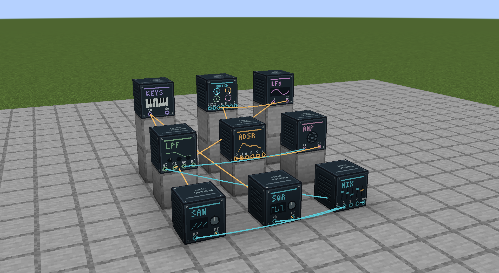
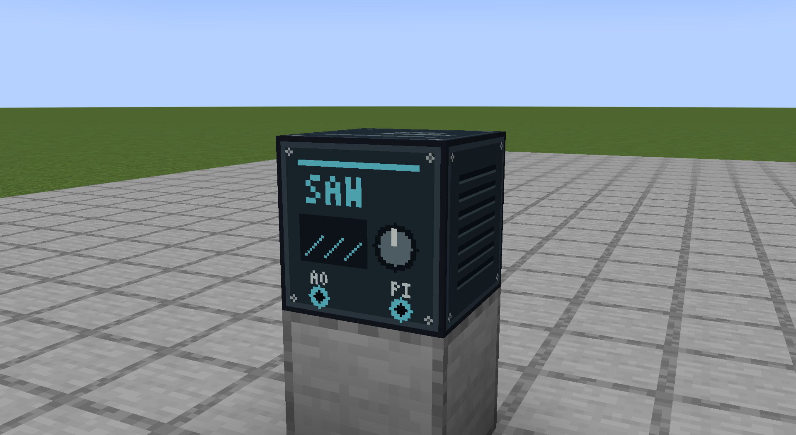
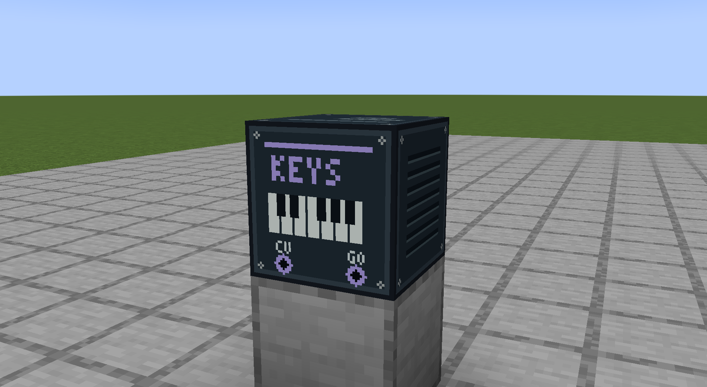
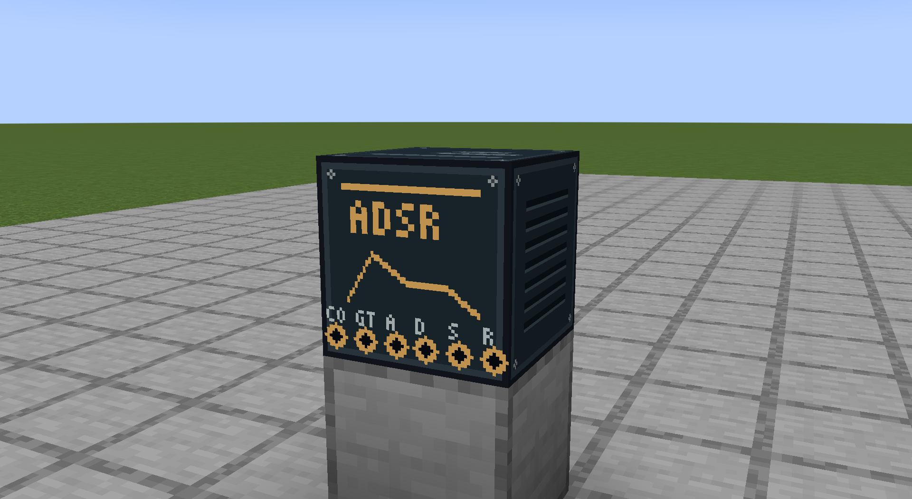
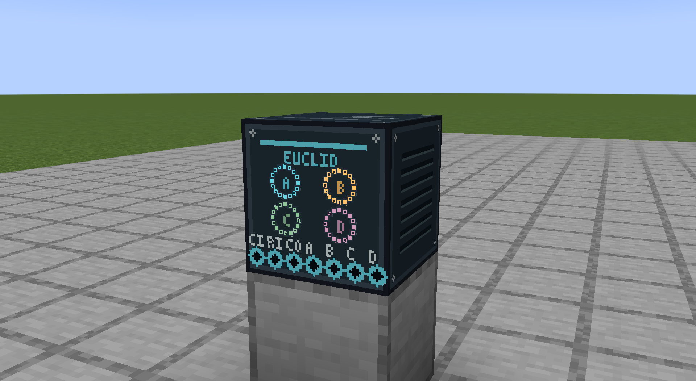
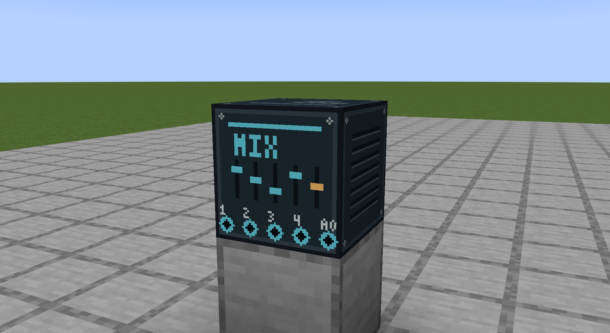
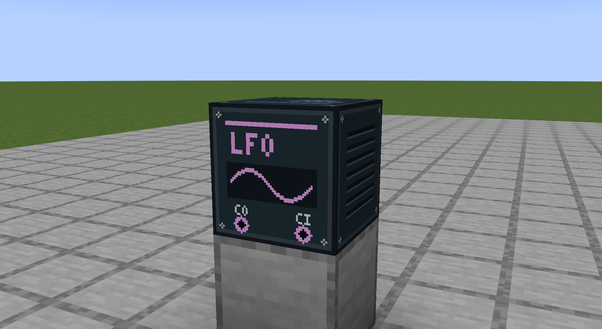

# ModularCraft

**Build a modular synthesizer inside Minecraft.** Place instruments as blocks, connect
their ports with cables, and turn oscillators, filters, and rhythms into a synth you can
play in your world. Nearby players hear the same shared performance, with their own
volume and mute controls.

Make a pulsing bass line, a slowly shifting drone, or a rhythm you can play over with a
keyboard. Sound is synthesized live—no prerecorded loops, accounts, external audio
services, or extra audio software are required. An optional MIDI controller can play
the Keyboard block too.

## Meet the blocks

| Sound sources | Tone and motion | Playing and output |
|---|---|---|
| **Saw Oscillator**  A bright starting point for basses, leads, and drones. Add unison detune for a thicker sound. | **Low-Pass Filter**  Soften a bright tone or add a resonant edge. Modulate cutoff and resonance to make it move. | **Keyboard**  Play notes with your mouse, computer keyboard, or a MIDI controller. Supplies pitch and gate signals. |
| **Square Oscillator**  Square and pulse tones with adjustable pulse width, from a hollow sound to a thinner buzz. | **Envelope Generator**  Shape how notes begin, sustain, and fade with attack, decay, sustain, and release. | **Euclidean Sequencer**  Create four rhythmic trigger patterns by spreading hits across steps. Clock other modules from the same rhythm. |
| **Audio Mixer**  Blend up to four audio sources. Adjust each level, mute parts, or solo a combination. | **LFO**  Add repeating motion with five wave shapes. Run freely or synchronize to the sequencer's clock. | **Amplifier / Speaker**  Bring the patch into the world as sound. Set its volume and use an envelope to shape loudness. |

The **Patching Tool** joins the blocks: right-click an output port, then a compatible
input. Cables carry audio, modulation, pitch, or timing signals. Right-click a block
without the tool to open its controls.

In the opening screenshot, both oscillators feed the mixer, then the filter and speaker.
The keyboard controls pitch, the sequencer triggers the envelope, and the LFO sweeps the
filter in time. [Build this complete synth](docs/user-guide.md#showcase-all-nine-blocks-together).

## Install and start playing

You need **Minecraft Java Edition 1.21.1**, **NeoForge 21.1.218**, and **Java 21**.

1. Get the installable `modularcraft-<version>.jar` from
   [GitHub Releases](https://github.com/oberones/ModularCraft/releases), or
   [build it from source](docs/development.md). The `-sources.jar` is not the playable mod.
2. Put the JAR in your Minecraft instance's `mods` folder. For multiplayer, install the
   same version on the server and every player's client.
3. Enter a world in Creative mode and open the **ModularCraft Instruments** inventory
   tab. All nine blocks and the Patching Tool are there. Survival recipes are not yet included.

ModularCraft is a **development candidate**. macOS is the initial playback target;
Windows/Linux playback is not yet qualified. See the [validation ledger](validation/ledger.md)
for current testing and outstanding release checks. Back up worlds before upgrading.

## Your first instrument

Start with a **Saw Oscillator**, **Low-Pass Filter**, **Envelope Generator**,
**Amplifier / Speaker**, and **Patching Tool**. Place the four blocks with centers two
blocks apart and their labeled fronts facing you. Keep their default settings.

1. With the tool, connect **Saw Audio Out → Filter Audio In**.
2. Connect **Filter Audio Out → Speaker Audio In**.
3. Connect **Envelope Out → Speaker Gain In**.
4. Put away the tool, open the speaker, and choose **Enable speaker**. Its default volume
   is 10%. It stays silent until you trigger the envelope.
5. Open the envelope and hold **Hold Gate** for a couple of seconds, then release it.
   Your note rises, sustains, and fades. Try changing the filter cutoff to change its tone.

**Press M to mute your own sound immediately.** Press it again to unmute. Open local
audio settings with the **ModularCraft Audio** button on the title screen, pause menu,
or module panels. Minecraft's Master and Jukebox/Note Blocks volume sliders also apply.
You can rebind M in Minecraft's controls. Local mute does not stop the music for other players.

To remove a cable, hold the Patching Tool and **Shift-right-click its destination input**.
An input accepts one cable; an output can feed four destinations. Speakers restart
disabled after reloading a world, so enable them when you return to your instrument.

## Keep exploring

- [User guide](docs/user-guide.md): detailed controls, playable patches, MIDI, saving,
  multiplayer ownership, and troubleshooting.
- [All-nine-block synth](docs/user-guide.md#showcase-all-nine-blocks-together): the wiring
  and settings used in the opening screenshot.
- [Development guide](docs/development.md): build, run, test, and capture screenshots.
- [Architecture](docs/architecture.md) and [validation ledger](validation/ledger.md):
  how the mod works and what has been tested.
