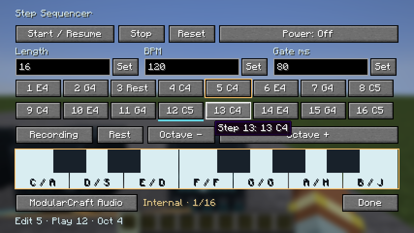
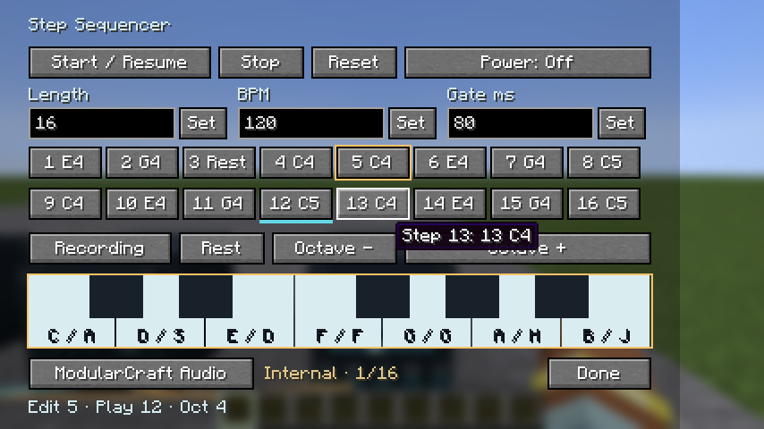
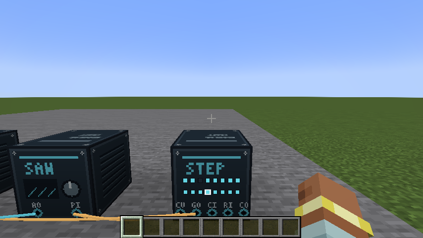

# Step Sequencer validation — 2026-11-07

Implemented ST-001–006 and RP-009. Runtime JAR SHA-256:
`dec3110a7109045a24b52c1a05c1acd593799c1728883b537d2381f4910cb5df`.
World/block schema remains 2; network/snapshot protocol is 12.

## Automated evidence

- **PASS:** `make verify GAMETEST_DIR=run/make/step-tests-20261107-3`: 25 launcher tests,
  196 JUnit tests, 48 packaged dedicated-server GameTests, strict dependency verification,
  formatting, Checkstyle, PMD, Java 21 package/resource inspection.
- Registration, recording state-machine, and malformed-checkpoint red runs are retained.
  Focused green tests cover note/rest progression, repeat gates, length retention, live edits,
  clock/reset/rewiring, round trips, note validation, acknowledgement and recording completion.
- Both saw and square render an octave change without receiving further snapshots. Twenty
  melodic checkpoints fit the existing 32 KiB cap. GameTests cover authorization, invalid/stale
  edits, NBT, redstone control and unload/reload with external clocks.
- **PASS:** `make smoke GRADLE_ARGS=-PqaStepSequencer TICKS=500`, fresh
  `run/make/smoke-kihg5oj9`: actual typing/repeat/rest/mouse entry, final-step disarm,
  compact widget bounds, playback projection and placed-block display. Screenshots inspected.
- **PASS, short-run thresholds only:** `make smoke-load GRADLE_ARGS=-PqaStepSequencer
  TICKS=1200`, fresh `run/make/smoke-load-7pf9p0yb`: four owners/patches, 80 modules,
  80 cables, four speakers, four detuned saws, 64 filters, 300 BPM. Initial portion overlapped
  final build/tests; later audio windows were captured after verification finished.

| Probe | Server p95 | Final rolling audio p95 | Audio max | Underruns |
|---|---:|---:|---:|---:|
| Editor/reference patch | 0.449250 ms | 0.047958 ms | 1.906166 ms | 1 |
| 80-module load | 0.641792 ms | 0.427667 ms | 5.038750 ms | 1 |

Load server maximum after warmup: 2.615041 ms; full-run server maximum: 8.048041 ms.
Largest reported load audio p95 window: 0.914583 ms. Thresholds are p95 <1 ms audio
and <2 ms mod-server work. These are measured rolling windows, not hard deadline guarantees.
Machine: Apple M2 Pro, 16 GiB RAM, macOS 26.6.2 arm64, Adoptium Java 21.0.12.1+1.
[Machine-readable results](results.json) retain every reported audio window.

## Failures retained and remaining gates

The first packaged run used an existing test world and encountered quarantined records.
A fresh run passed 47/48 with a sustained-clock timeout during accelerated GameTests;
a subsequent fresh run passed all new tests but failed the existing occupied-offhand
cable-removal test. Final isolated verification passed all 48 without relaxing assertions.
The copied Step test methods now have unique names to distinguish them in reports.
These intermittent failures remain recorded in `logs/`; they are not erased by the final pass.

**PENDING:** zero-underrun qualification, human listening/acoustic checks, physical input
and two-client timing/accessibility checks, 30-minute sustained load, and prior
security/platform/release gates. Native probes are automated input, not human acceptance.
No player worlds were removed, no dependencies changed, and no commit, push, publication,
or normal play/server installation was performed.

## Self-review

**PASS:** checked separate audio/server/visual runtime ownership; no per-step networking;
fixed-size notes and bounded event scheduling; pitch/gate/reset order and retained pitch on
rests; revision-acknowledged recording with no Keyboard performance session; named save
compatibility and strict protocol 12; unloaded cleanup and source quarantine preservation.
Visual review includes the compact editor and sixteen placed-block indicators.

